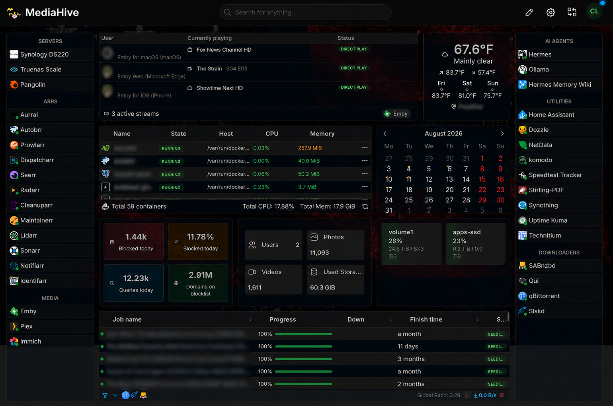
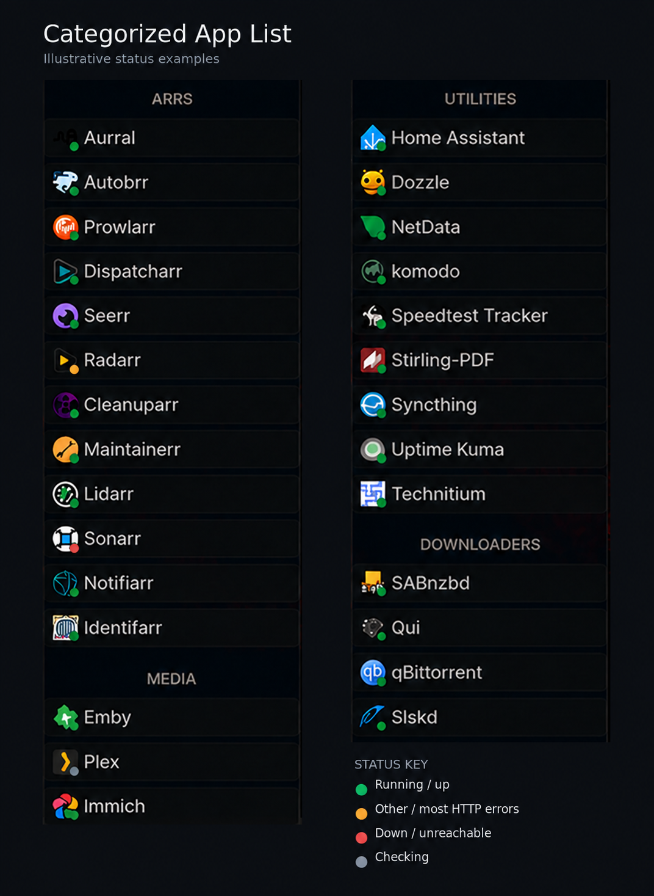
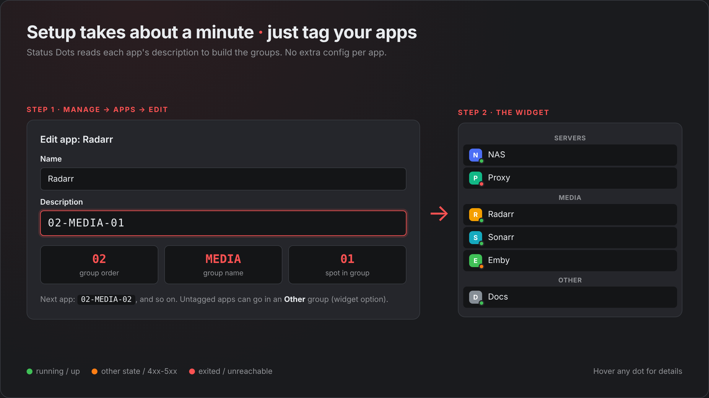

# Categorized App List with Status Dots

App links grouped into categories, with Docker or HTTP status dots. Built for Homarr Custom Widgets.

**[Install from Homarr Workshop](https://homarr.dev/workshop/8y1z2nta8mutdx8)** · [Download the manifest](widget.json)

## Screenshots

The same three images shown on the Workshop listing, in the same order.

### Dashboard example

*Dashboard example from the Workshop listing. Existing privacy redactions are preserved; this is not a current service-status report.*

### Status examples

*Illustrative apps and statuses, not live observations. See the status table below for the exact behavior.*

### Setup

*Tag app descriptions to control grouping and order.*

## Requirements

- Homarr 2.0+ with Custom Widgets support.
- An admin API token for your Homarr instance.
- Docker configured in Homarr for container status. If container status is unavailable, the widget can fall back to HTTP checks.
- A Homarr URL reachable **from the Homarr server**, not just your browser. Do not use `localhost`.

The widget uses Homarr's internal tRPC routes as well as `/api/apps`. Those routes can change between Homarr versions; compatibility with every future version is not guaranteed.

## Install

1. Install from Workshop, or download `widget.json` and open **Management → Custom Widgets → Import** in Homarr.
2. Create an API token under **Management → Tools → AI & MCP → Authentication → Create API token**. Copy it immediately; it is only shown once.
3. Add the token to the widget's source credentials under the **ApiKey** header. Never paste it into the manifest or commit it to git.
4. Change the default API source from `https://homarr.example.com` to your real Homarr URL. The example address is a placeholder and will not work as-is.
5. Set app descriptions to `NN-CATEGORY-NN`, then place the widget on your board.

For example:

| App | Description | Result |
| --- | --- | --- |
| Radarr | `02-MEDIA-01` | MEDIA group, first app |
| Sonarr | `02-MEDIA-02` | MEDIA group, second app |
| Docs | `03-TOOLS-01` | TOOLS group, first app |

The first number controls category order; the text is the category label; the final number controls order within the category.

## Options

| Option | Default | What it does |
| --- | --- | --- |
| Categories to show | All categories | Select a range, odd categories, or even categories. Use multiple widget instances to split the list into columns. |
| HTTP check for apps without a container | On | Uses Homarr's ping URL, or the app link, for apps without a matching container. |
| Show apps without a category | Off | Adds untagged apps to an Other group. Other ignores the category filter, so enable it in only one instance when splitting columns. |
| Container name overrides | Empty | Comma-separated `app=container` pairs, e.g. `immich=immich-server`. Matching ignores case, spaces, and punctuation. |
| Fuzzy container matching | Off | Allows partial matches. Can pick the wrong container; explicit overrides are safer. Adds work per app, so on larger setups (about 40+ apps) it can hit Homarr's template limit. |
| Category columns | 1 | Shows categories side by side, up to 6 columns. Empty columns are dropped, so you never get more columns than categories. Pick a number that fits your widget width; it does not adjust automatically. |
| Save space | Off | With 2+ columns, puts each category in the shortest column so the widget stays as short as possible. Category order across columns can change. |

## Status dots

| Source | Condition | Color |
| --- | --- | --- |
| Docker | Running | Green |
| Docker | Exited or dead | Red |
| Docker | Other state | Orange |
| HTTP | 2xx, 3xx, 401, or 403 | Green |
| HTTP | 502–504 or an invalid/missing status code in a returned result | Red |
| HTTP | Other 4xx or 5xx | Orange |
| HTTP | Checking | Gray |

Hover a dot for details. HTTP green means reachable, not necessarily healthy or authenticated; a running container is not proof that its application is healthy.

App cards remain outside the HTTP request callback. A request-level batch failure uses Homarr's built-in error UI within the dot area, rather than a returned HTTP-code dot.

## Requests and limits

- Loads the app list from `/api/apps` and Docker state from `/api/trpc/docker.getContainers`.
- HTTP fallback uses Homarr's internal `widget.app.ping` procedure in one variable-length batch, cached for 60 seconds. Homarr's native app ping uses HEAD, so a service that rejects HEAD may show an error even when its page opens.
- At most **24 unmatched apps per widget instance** receive HTTP checks; additional unmatched apps have no HTTP dot. Disabling fallback leaves unmatched apps without dots.
- If Docker status fails, a note is shown and HTTP fallback may check unmatched apps, subject to the same cap.
- Caching is not the board refresh interval. Multiple widget instances can increase request volume.
- Requests run through Homarr; this manifest contains no external telemetry endpoint.
- Homarr limits how much work a widget template can do per render. Tested comfortably at about 50 apps with fuzzy matching off and about 40 with it on; much bigger lists can show a template-limit error. Splitting categories across several widget instances keeps each one smaller.

## Privacy

The public manifest has a generic source URL and empty container overrides. Configure credentials in Homarr, not in `widget.json`.

Keep private exports and mappings outside the repository, or in ignored `private/`, `local/`, or `*.local.json` files. A private branch in a public repository is **not** private. Ignore rules do not remove files already tracked by git, and deleting a secret from a later commit does not erase it from history.

Before publishing, inspect staged files, screenshots, and the complete git history for secrets, internal addresses, private app names, and mappings. Automated checks are a guardrail, not a complete secret scanner.

## Development and releases

This repo starts with the exact public source from **Workshop revision 17**; no widget code was changed for the initial import. See [CHANGELOG.md](CHANGELOG.md) and [the import provenance](PROVENANCE.md).

1. Edit the public `widget.json`; keep personal configuration separate.
2. Run `python3 scripts/check_public.py` (also run by GitHub Actions).
3. Import into a test definition/board and use Homarr's fresh preview validation. Exercise loading, errors, empty lists, Docker-unavailable fallback, both themes, and your relevant options before touching a live instance.
4. Check a clean install and an upgrade from the previous revision. Static checks alone do not validate JSX or prove runtime compatibility.
5. Update the changelog, review the complete diff, and commit.
6. Publish to Workshop after review, read back its saved source, and compare it with the committed manifest. Tag the matching commit `workshop-rN`.

GitHub is the source history and feedback channel; Workshop remains the installation/discovery page. Nothing here automatically deploys to Homarr or publishes Workshop revisions.

## Credits

The category columns and save-space layout in revision 18 came from [@Lefky](https://github.com/Lefky)'s suggestion in [#1](https://github.com/Clarkar00/homarr-categorized-app-list/issues/1).

## Feedback and license

Issues and pull requests are welcome. Include your Homarr version, a redacted error, and steps to reproduce. Do not post API tokens, private URLs, or unredacted exports.

[MIT License](LICENSE).
